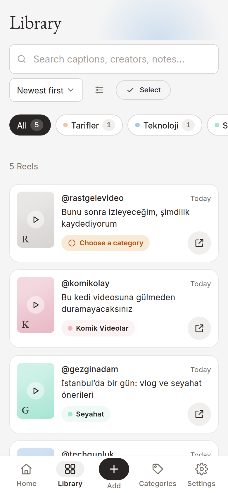
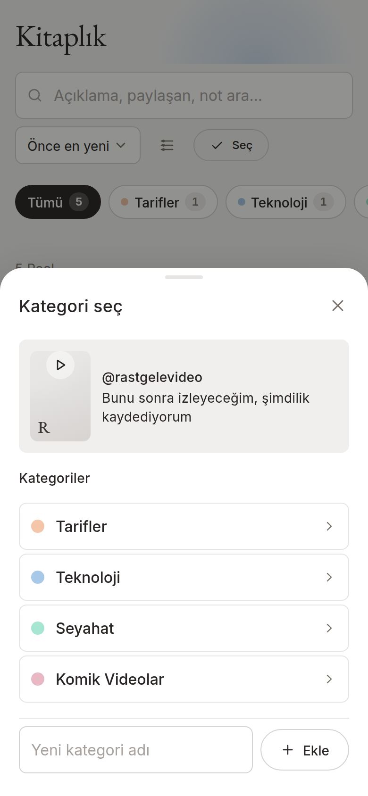
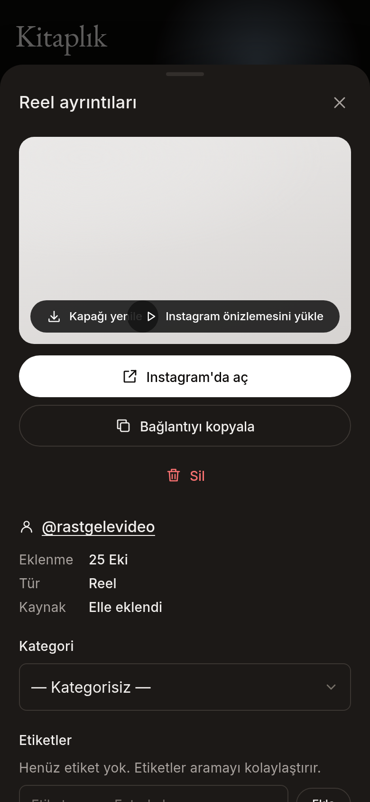
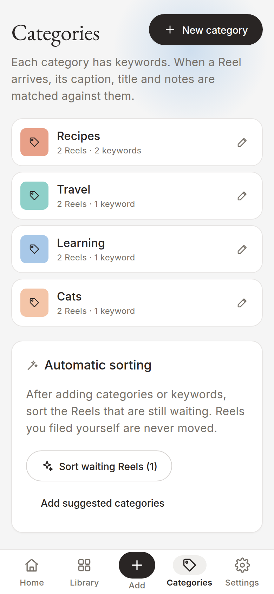
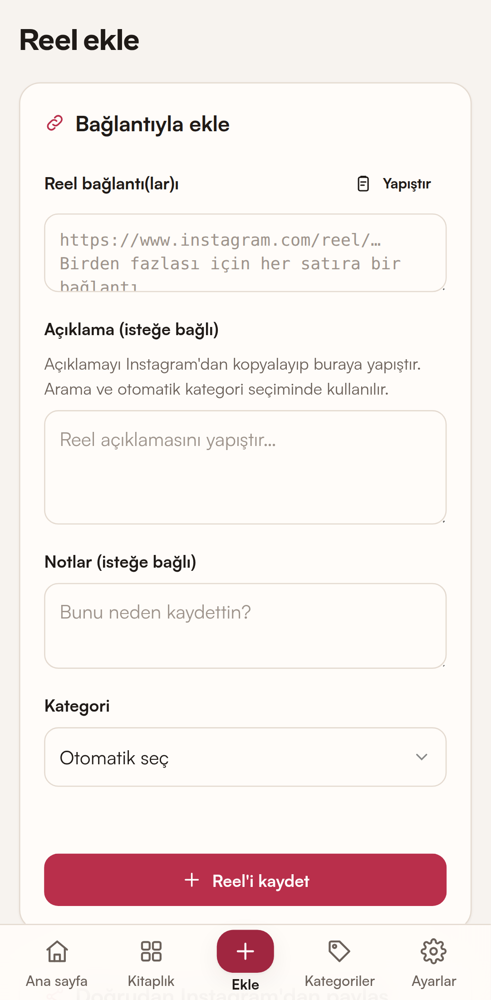
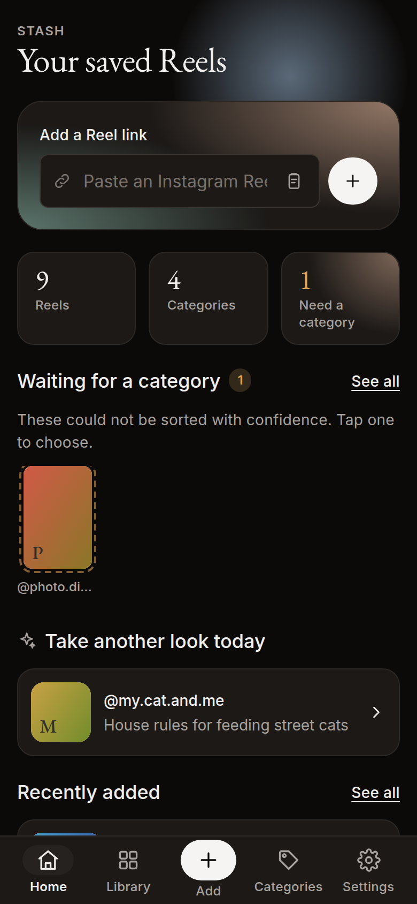
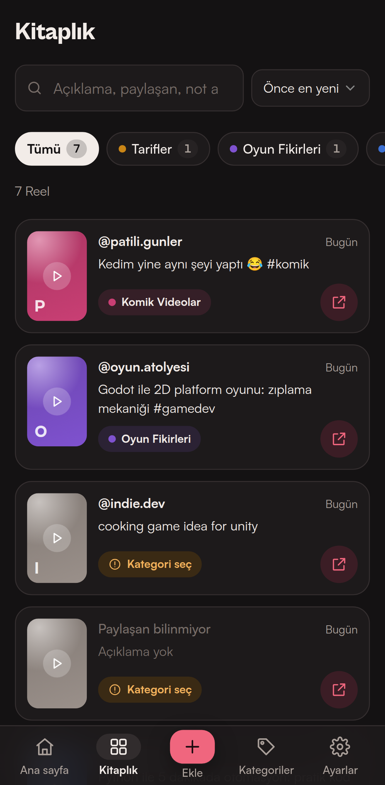

<div align="center">


# Stash

### Your saved Instagram Reels, sorted into your own categories.

A local-first Android app. Share a Reel, and Stash files it where it belongs. No account, no server, no Instagram login.

[](https://github.com/firatnexus/Stash/actions/workflows/ci.yml)
[](https://github.com/firatnexus/Stash/actions/workflows/android.yml)
[](https://github.com/firatnexus/Stash/releases/latest)


[**Download the APK**](https://github.com/firatnexus/Stash/releases/latest) · [Features](#features) · [How it works](#how-it-works) · [What works with Instagram](#what-works-with-instagram) · [Privacy](#privacy) · [Development](#development)

</div>

<br />

<table align="center">
  <tr>
    <td align="center"></td>
    <td align="center"></td>
    <td align="center"></td>
    <td align="center"></td>
  </tr>
  <tr>
    <td align="center"><sub><b>Home</b><br />Quick add, stats, review queue</sub></td>
    <td align="center"><sub><b>Library</b><br />Search, sort, category and tag filters</sub></td>
    <td align="center"><sub><b>Choose a category</b><br />Suggestions you confirm</sub></td>
    <td align="center"><sub><b>Reel details</b><br />Dark theme</sub></td>
  </tr>
  <tr>
    <td align="center"></td>
    <td align="center"></td>
    <td align="center"></td>
    <td align="center"></td>
  </tr>
  <tr>
    <td align="center"><sub><b>Categories</b><br />Colors, keywords, starters</sub></td>
    <td align="center"><sub><b>Add</b><br />Links, bulk paste, data export</sub></td>
    <td align="center"><sub><b>Home</b><br />Dark theme</sub></td>
    <td align="center"><sub><b>Library</b><br />Dark theme</sub></td>
  </tr>
</table>

<p align="center"><sub>Screenshots use demo data. The gradient covers are placeholders; real covers are downloaded from Instagram on the device.</sub></p>

---

## Why Stash

Instagram's own "Saved" tab is one long, unsorted list. Stash gives every Reel you save a home: recipes with recipes, travel with travel, lessons with lessons. It works entirely on your phone, never asks for your Instagram password, and when it is not sure where something belongs, **it asks you instead of guessing**.

## Features

### Saving

- **Share from Instagram.** On any Reel, tap **Share → Save to Stash**. The link is saved and sorted.
- **Paste links.** One link or many (one per line), plus a one-tap paste from the clipboard.
- **Import your Instagram data export.** Add everything from Instagram's "Download your information" ZIP, JSON or HTML in one go. Instagram collections can become categories.
- **Duplicate detection.** `instagram.com/reel/…`, `/reels/…`, `m.instagram.com` and `?igsh=` variants are recognized as the same Reel.
- **Clipboard offer.** When the app comes to the foreground with an unsaved Instagram link on the clipboard, it offers to add it. Nothing is added until you tap.

### Sorting

- **Your own categories.** Create, rename, color, add keywords to and delete them. Starter categories such as Recipes, Game Ideas, Tech, Travel, Funny Videos and Learning come with Turkish and English keywords.
- **Trustworthy auto-categorization.** Scores keywords, hashtags, Instagram collections and your earlier choices for the same creator. If the result is not clear, the Reel waits for you in **Waiting for a category**.
- **Optional AI.** OpenAI, Gemini, OpenRouter, Anthropic or any OpenAI-compatible endpoint, with your own key. Used only if you turn it on, and only for Reels that have real text and that keywords could not sort.
- **Tags.** Add them yourself, or accept 3 to 5 AI suggestions with a tap. Suggestions are never applied automatically.

### Finding

- **Home and Library.** Home is a compact dashboard: quick add, stats, a daily "Take another look today" pick and the review queue. The Library holds the full collection with search, sorting, category and tag filters, list or grid view and multi-select bulk categorize or delete.
- **Fast search** across captions, creators, notes, tags and category names. Search ignores Turkish diacritics, so `sarki` finds "şarkı".
- **Cover images.** At save time the cover and creator are fetched from Instagram's public embed page and stored on the device as small WebP files (480px max). Includes "Refresh cover", a one-time "Update existing reels" backfill and cache controls in Settings.

### Feel

- **Native touches.** Animated splash screen with no white flash, swipe-down-to-close sheets, haptics and pressable buttons.
- **Editorial design.** EB Garamond headings, Inter body text, soft pastel orbs, pill buttons and a matching dark theme.
- **Turkish and English UI**, light and dark theme, Android back button support and a fully offline launch (fonts included in the APK).
- **Backup and restore.** Export the whole library as JSON (`stash-backup-YYYY-MM-DD.json`); restore by merging or replacing. Backups from older versions still restore.

## Install

1. On your phone, open the [latest release](https://github.com/firatnexus/Stash/releases/latest) and download `stash-x.y.z.apk`.
2. Open the file. If Android asks, allow **Install unknown apps** for your browser or file manager.
3. Tap **Install**, then open Stash.
4. In Instagram, on a Reel tap **Share** (paper plane) → **More / Share to…** → **Save to Stash**. The first time it may be at the end of the list; long-press to pin it.

> [!NOTE]
> Requires Android 6.0 or later and an up-to-date **Android System WebView** (Chrome 111+), which updates automatically through the Play Store.

> [!TIP]
> Updates are signed with the same key, so a new APK installs over the old one and keeps your data.

Because Stash is not on the Play Store, Play Protect may show an "unrecognized app" warning. The app requests no runtime permissions; only `INTERNET` (for opening Reels in Instagram, the optional preview and the optional AI) and `VIBRATE` (for button-press haptics) are declared.

## How it works

```text
Instagram ──Share──▶ Android share sheet ──ACTION_SEND──▶ ReelsBridge (Java)
                                                                │
Paste a link / bulk add / data export file ─────────────────────┤
                                                                ▼
                 instagram/url.js   ─▶ validate, canonical URL, duplicate key
                 categorize/engine  ─▶ keywords + collections + creator history
                                       (not sure) ─▶ optional AI
                                       (still not sure) ─▶ ask the user
                 instagram/embed    ─▶ cover / creator / caption from the public embed page
                                       (skipped silently on failure)
                 storage/repo.js    ─▶ IndexedDB (reels, categories, settings)
```

### Choosing a category

| Signal | Weight | Note |
| --- | --- | --- |
| Category name appears in the text | 1.5 | |
| Keyword (whole word) | 1.0 | |
| Hashtag match (`#gamedev`, `#easyRecipe`) | ×1.5 | camelCase and underscores are split |
| Multi-word phrase (`akşam yemeği`) | 1.2 | |
| Prefix (`tarif` → `tarifi`) | 0.8 | |
| Instagram collection name equals a category name or keyword | +3 | from the data export |
| Your earlier choices for the same creator | up to +2 | only manual choices count |

A Reel is filed automatically when the best score is **at least 1** and **at least twice** the runner-up. Otherwise it goes to **Waiting for a category** with suggestions. If there is no text (for example only a link was shared), Stash does not invent a caption; it leaves the choice to you or suggests pasting the caption.

With AI turned on, the model is called only when the local result is uncertain and the Reel has real text. It suggests up to 3 existing categories and at most 1 new one. **No AI result is ever applied automatically**: the category picker still asks you, even at high confidence. It also suggests 3 to 5 tags, which you confirm with a tap ("Reject all" dismisses them). Settings shows exactly what is sent (only the Reel text and category names), and suggestions can be turned off entirely.

## What works with Instagram

Stash **never signs in to Instagram**. It does not ask for passwords or cookies and does not read pages in the background. These limits are deliberate and shape the table below.

| Feature | Status | Depends on |
| --- | --- | --- |
| Share → Save to Stash from Instagram | ✅ Works | Android share sheet (`ACTION_SEND text/plain`). Instagram shares **only the link**. |
| Paste a link, bulk add, paste from clipboard | ✅ Works offline | — |
| Bulk import from Instagram's data export | ✅ Works offline | Instagram's export format (`your_instagram_activity/saved/saved_posts.json`, `saved_collections.json`). If Meta changes it, the parser may need an update. |
| Duplicate detection | ✅ Works | Exact for links with a shortcode. Newer `instagram.com/share/…` links cannot be resolved offline; only repeats of the same share link are caught. |
| Open in Instagram | ✅ Works | Opens in the Instagram app if installed, otherwise in the browser (needs internet). |
| Creator username | ✅ Mostly | Fetched and stored at save time from the public embed page; otherwise taken from the link, the shared text or the export. |
| Caption | ✅ Mostly | Fetched at save time from the embed page. Instagram does not include it when sharing; you can paste it yourself. |
| Cover image | ✅ At save time | Meta removed `thumbnail_url` from oEmbed responses, so the public embed page is used; the cover is stored as WebP (480px max). Private or removed content gets no cover; "Refresh cover" retries. |
| Automatically pulling your saved posts from Instagram | ❌ Not available | Instagram's official API does not expose saved posts for personal accounts. Tools that do this use passwords or cookies; Stash does not. Use the **data export** for bulk import. |

### Getting your Instagram data export

1. Instagram → **Settings and privacy** → **Accounts Center** → **Your information and permissions** → **Download your information**.
2. **Download or transfer information** → your Instagram account → **Some of your information** → **Saved**.
3. **Download to device**, format **JSON**, date range **All time**.
4. When it is ready, download the ZIP and pick it in Stash under **Add → Import from Instagram data export**. No need to unzip it.

## Privacy

- All data lives in IndexedDB on your device. Stash has no server.
- Android cloud backup and device-to-device transfer are turned off (`allowBackup=false`, `data_extraction_rules.xml`). Use the in-app JSON backup to move your library.
- The network is used only when: the cover and creator are fetched at save time (only `instagram.com/reel/…/embed`), you open a Reel in Instagram, you load the embedded preview yourself (connects to Instagram), or you turned on AI (the Reel text and category names go to the provider you picked).
- Your AI API key is stored only on the device and is **never** written to backups.

## Development

Requirements: Node.js 20+, JDK 21, Android SDK (platform 35, build-tools 35).

```bash
npm ci
npm run serve          # serves www/ at http://localhost:5173 for fast browser development
npm test               # unit tests (node:test)
npx playwright install chromium
npm run test:e2e       # end-to-end tests (phone and desktop viewports)
npm run screenshots    # regenerates docs/screenshots/ with English demo data (LANG_UI=tr for Turkish)
npm run apk:debug      # android/app/build/outputs/apk/debug/app-debug.apk
```

To work in Android Studio: `npm run sync && npx cap open android`.

### Signed release APK

Create `android/keystore.properties` (ignored by git) or use environment variables:

```properties
storeFile=/absolute/path/stash-release.jks
storePassword=…
keyAlias=stash
keyPassword=…
```

```bash
npm run apk:release    # android/app/build/outputs/apk/release/app-release.apk
```

To sign on GitHub Actions with the same key, add these repository secrets: `RO_KEYSTORE_BASE64` (`base64 -w0 release.jks`), `RO_KEYSTORE_PASSWORD`, `RO_KEY_ALIAS`, `RO_KEY_PASSWORD`. Without them the workflow builds a debug APK.

### Releasing a new version

1. Bump `APP_VERSION` and `VERSION_CODE` in `www/src/version.js` (Gradle reads the version from there) and `version` in `package.json`.
2. Add a `## X.Y.Z — YYYY-MM-DD` section at the top of `CHANGELOG.md`. A unit test fails if the current version has no section.
3. `git tag vX.Y.Z && git push origin vX.Y.Z`.

The **Android APK** workflow builds the APK, writes `SHA256SUMS.txt`, and creates or updates the GitHub release. The release body contains **only that version's changelog section** plus download details, install steps and highlights from [`.github/release-template.md`](.github/release-template.md), rendered by [`scripts/release-notes.mjs`](scripts/release-notes.mjs).

### Project structure

```text
www/                        web layer that Capacitor packages into the APK (no build step, plain ES modules)
├─ index.html
├─ styles/app.css           mobile-first UI, light and dark theme
├─ fonts/                   EB Garamond + Inter variable fonts (OFL 1.1, bundled)
├─ vendor/capacitor.js      @capacitor/core runtime (copied by scripts/vendor.mjs)
└─ src/
   ├─ app.js                router, share queue, back button
   ├─ version.js            APP_VERSION and VERSION_CODE
   ├─ instagram/            url.js (parse, validate, canonical URL) · embed (covers, creator)
   ├─ categorize/           normalize · keyword · creator · ai · engine · starters
   ├─ io/                   zip reader · Instagram export parser · JSON backup
   ├─ storage/              IndexedDB (db.js) and repository layer (repo.js)
   ├─ core/                 store (app state) · platform (native bridge) · i18n
   └─ ui/                   DOM helpers · components · theme · views/
android/                    Capacitor 7 Android project
└─ app/src/main/java/io/github/firatnexus/stash/ReelsBridgePlugin.java   share intake, open in Instagram, file save, clipboard, system bars
tests/unit/                 node:test + fake-indexeddb
tests/e2e/                  Playwright: core workflows + data export import
scripts/                    serve · vendor · make_icons · release-notes · perf/ (screenshots, scroll profiling)
.github/                    CI, Android APK workflow and the release template
```

### What the tests cover

| Workflow | Tests |
| --- | --- |
| 1. Create, rename and delete categories, duplicate names, starter categories | `e2e: 1 ·`, `store.test` |
| 2. Add a Reel link, invalid link errors, duplicate detection | `e2e: 2+3 ·`, `url.test`, `store.test` |
| 3. Automatic category, asking when unsure, manual change | `e2e: 2+3 ·`, `categorize.test` |
| 4. Search (diacritic-insensitive), filters, sorting | `e2e: 4 ·` |
| 5. Open in Instagram | `e2e: 5 ·` (popup in the browser; `ACTION_VIEW` on Android) |
| 6. Export a backup → delete → restore | `e2e: 6 ·`, `store.test` |
| 7. Launch, every screen reachable, no external requests | `e2e: 7 ·` + APK build in CI |
| 8. Add a Reel via share (cold and warm start) | `e2e: 8 ·` (the Android intent payload is simulated with `?text=`) |
| 9. Drag to dismiss sheets | `e2e: 9 ·` |
| Instagram ZIP import, mojibake repair, collections | `instagram-export.test`, `e2e` |
| Cover and creator parsing from the embed page | `embed.test` |
| Turkish and English translation keys are complete | `i18n.test` |
| Upgrading from the legacy `reels-organizer` database | `db-migration.test` |
| Release notes contain only the current version | `release-notes.test` |

The real Android share sheet and the hand-off to the Instagram app are simulated in automated tests; verify them by hand on a device.

## Known limitations

- Covers are available only for public Reels with a real shortcode.
- `instagram.com/share/…` links cannot be resolved offline, so duplicate detection for them is limited.
- Performance was profiled in desktop Chromium; no physical-device measurement yet.
- Uninstalling the app or clearing its data removes your library, so keep a JSON backup.

## Version history

| Version | Date | Highlights |
| --- | --- | --- |
| **1.2.2** | 2026-10-28 | Internal names renamed to Stash with automatic data migration |
| 1.2.1 | 2026-10-28 | Hidden WebView scrollbar, English docs, per-version release notes |
| 1.2.0 | 2026-10-25 | Editorial design refresh: EB Garamond + Inter, pastel orbs, pill buttons |
| 1.1.1 | 2026-10-22 | Renamed to Stash |
| 1.1.0 | 2026-10-22 | Covers, tags, Home / Library split, splash screen, AI tag suggestions |
| 1.0.0 | 2026-10-22 | First release |

Full details in [CHANGELOG.md](CHANGELOG.md). Stash was formerly called **Reels Organizer**. The `applicationId` (`io.github.firatnexus.reelsorganizer`) is deliberately unchanged, so every version installs over the previous one; since 1.2.2 everything else uses the Stash name, and data from the old `reels-organizer` database and backups is migrated automatically.

## License

[MIT](LICENSE). EB Garamond and Inter are licensed under the [SIL Open Font License 1.1](www/fonts/).
