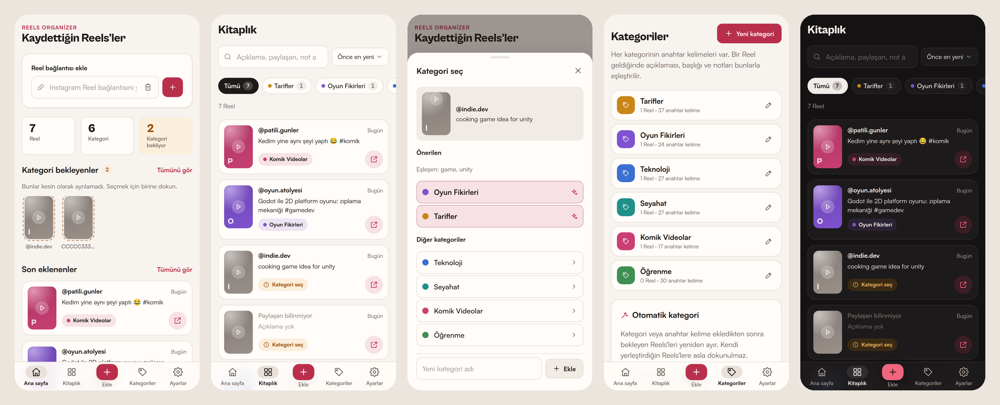

<div align="center">


# Reels Organizer

**Instagram'da kaydettiğin Reels'leri kendi kategorilerine ayıran, tamamen cihazında çalışan Android uygulaması.**

[](https://github.com/firatnexus/reels-organizer/actions/workflows/ci.yml)
[](https://github.com/firatnexus/reels-organizer/actions/workflows/android.yml)
[](https://github.com/firatnexus/reels-organizer/releases/latest)


[**APK'yı indir**](https://github.com/firatnexus/reels-organizer/releases/latest) · [Nasıl çalışır](#nasıl-çalışır) · [Instagram ile ne çalışır?](#instagram-ile-ne-çalışır-ne-çalışmaz) · [Geliştirme](#geliştirme) · [English](#english)



</div>

---

## Özellikler

- **Instagram'dan paylaş → kaydet.** Instagram'da bir Reel'de *Paylaş → Reels Organizer*'a dokun; bağlantı kaydedilir ve kategoriye ayrılır.
- **Bağlantı yapıştır.** Tek bağlantı ya da her satıra bir tane olacak şekilde toplu ekleme. Panodan tek dokunuşla yapıştırma.
- **Instagram veri dışa aktarımını içe al.** Instagram'ın "Bilgilerini indir" ZIP/JSON/HTML dosyasındaki kaydedilenleri tek seferde ekler. Instagram koleksiyonlarını kategori olarak alabilir.
- **Kendi kategorilerin.** Oluştur, yeniden adlandır, renk ve anahtar kelime ver, sil. Tarifler, Oyun Fikirleri, Teknoloji, Seyahat, Komik Videolar, Öğrenme gibi hazır öneriler TR/EN anahtar kelimelerle gelir.
- **Güvenilir otomatik kategori.** Anahtar kelime, hashtag, Instagram koleksiyonu ve senin önceki seçimlerine (aynı paylaşan) göre puanlar. Emin değilse **sana sorar**; tahmin uydurmaz.
- **İsteğe bağlı yapay zekâ.** OpenAI, Gemini, OpenRouter, Anthropic ya da OpenAI uyumlu herhangi bir uç nokta. Yalnızca sen açarsan ve yalnızca anahtar kelimelerin ayıramadığı, metni olan Reels için kullanılır.
- **Hızlı bulma.** Açıklama, paylaşan, not ve kategori adında arama (Türkçe karakterlere duyarsız: `sarki` → "şarkı"), kategori filtreleri, en yeni/en eski sıralama.
- **Kopya kontrolü.** `instagram.com/reel/…`, `/reels/…`, `m.instagram.com`, `?igsh=` gibi farklı biçimler aynı Reel olarak tanınır.
- **Yedekle / geri yükle.** Tüm kitaplığı JSON olarak dışa aktar; birleştirerek ya da tamamen değiştirerek geri yükle.
- **Yerel ve özel.** Hesap yok, sunucu yok, analitik yok. Veriler IndexedDB'de, cihazında kalır. Android bulut yedeğine de gönderilmez.
- Türkçe / İngilizce arayüz, açık/koyu tema, Android geri tuşu desteği, tamamen çevrimdışı açılış (fontlar dahil her şey APK içinde).

## Kurulum (APK)

1. Telefonundan [son sürüm sayfasını](https://github.com/firatnexus/reels-organizer/releases/latest) aç ve `reels-organizer-x.y.z.apk` dosyasını indir.
2. Dosyayı aç. Android "bilinmeyen uygulamaları yükleme" izni isterse tarayıcın (ya da dosya yöneticin) için **bu kaynağa izin ver**'i aç.
3. **Yükle**'ye dokun, ardından uygulamayı aç.
4. Instagram'da bir Reel'de **Paylaş** (kâğıt uçak) → **Diğer / Şuraya paylaş…** → **Reels Organizer**. İlk seferde listede en sona düşebilir; uzun basıp sabitleyebilirsin.

> Android 6.0 ve üzeri, güncel bir **Android System WebView** (Chrome 111+) gerekir; Play Store üzerinden otomatik güncellenir.
>
> Play Store'da yayınlanmadığı için Play Protect "tanınmayan uygulama" uyarısı gösterebilir. Uygulama hiçbir izin istemez; yalnızca `INTERNET` (Reel'i Instagram'da açmak, isteğe bağlı önizleme ve yapay zekâ için) bildirilir.
>
> Güncellemeler aynı imza anahtarıyla imzalanır, yeni APK'yı eskisinin üzerine kurabilirsin; veriler korunur.

## Nasıl çalışır

```text
Instagram ──Paylaş──▶ Android paylaşım menüsü ──ACTION_SEND──▶ ReelsBridge (Java)
                                                                    │
Bağlantı yapıştır / toplu ekle / dışa aktarım dosyası ───────────────┤
                                                                    ▼
                     instagram/url.js  ─▶ doğrula, kanonik URL, kopya anahtarı
                     categorize/engine ─▶ anahtar kelime + koleksiyon + paylaşan geçmişi
                                         (emin değilse) ─▶ isteğe bağlı yapay zekâ
                                         (hâlâ emin değilse) ─▶ kullanıcıya sor
                     storage/repo.js   ─▶ IndexedDB (reels, categories, settings)
```

### Kategori seçimi

| Sinyal | Ağırlık | Not |
| --- | --- | --- |
| Kategori adı metinde geçiyor | 1.5 | |
| Anahtar kelime (tam kelime) | 1.0 | |
| Hashtag ile eşleşme (`#gamedev`, `#easyRecipe`) | ×1.5 | camelCase/alt çizgi bölünür |
| Çok kelimeli ifade (`akşam yemeği`) | 1.2 | |
| Önek (`tarif` → `tarifi`) | 0.8 | |
| Instagram koleksiyon adı = kategori adı veya anahtar kelimesi | +3 | dışa aktarımdan gelir |
| Aynı paylaşan için senin önceki seçimlerin | en fazla +2 | yalnızca elle yaptığın seçimler sayılır |

En iyi puan **≥ 1** ve ikincinin **en az 2 katı** ise Reel otomatik eklenir. Değilse "Kategori bekleyenler"e düşer ve önerilerle birlikte seçmen istenir. Metin yoksa (örneğin sadece bağlantı paylaşıldıysa) uygulama açıklama uydurmaz; seçimi sana bırakır ya da açıklamayı yapıştırmanı önerir.

Yapay zekâ açıksa: yalnızca yerel sonuç *emin değilse* ve Reel'in gerçek bir metni varsa çağrılır. Model yalnızca senin kategori adlarından birini döndürebilir; güven ≥ 0.6 ise otomatik eklenir, altındaysa sadece öneri olur.

## Instagram ile ne çalışır, ne çalışmaz?

Bu uygulama Instagram'a **giriş yapmaz**, şifre veya çerez istemez, sayfaları arka planda okumaz. Bu kısıtlar bilinçli ve aşağıdaki tabloyu belirler:

| Özellik | Durum | Neye bağlı |
| --- | --- | --- |
| Instagram'dan *Paylaş → Reels Organizer* | ✅ Çalışır | Android paylaşım menüsü (`ACTION_SEND text/plain`). Instagram yalnızca **bağlantıyı** paylaşır. |
| Bağlantı yapıştırma, toplu ekleme, panodan yapıştırma | ✅ Çalışır, çevrimdışı | — |
| Instagram veri dışa aktarımından toplu içe aktarma | ✅ Çalışır, çevrimdışı | Instagram'ın dışa aktarım biçimi (`your_instagram_activity/saved/saved_posts.json`, `saved_collections.json`). Meta biçimi değiştirirse ayrıştırıcının güncellenmesi gerekebilir. |
| Kopya algılama | ✅ Çalışır | Kısa kod içeren bağlantılarda tam. Yeni `instagram.com/share/…` bağlantıları çevrimdışı çözülemez; bunlarda yalnızca aynı paylaşım bağlantısı tekrar edilirse yakalanır. |
| "Instagram'da aç" | ✅ Çalışır | Instagram uygulaması yüklüyse orada, değilse tarayıcıda açılır (internet gerekir). |
| Paylaşan kullanıcı adı | ⚠️ Bazen | Yalnızca bağlantıda (`/kullanici/reel/…`), paylaşılan metinde veya dışa aktarımda varsa. |
| Açıklama (caption) | ⚠️ Elle | Instagram paylaşırken açıklamayı göndermez. Açıklamayı kopyalayıp yapıştırabilirsin; arama ve otomatik kategori bunu kullanır. |
| Küçük resim | ❌ Yok | Meta, 3 Kasım 2025'ten itibaren oEmbed yanıtlarından `thumbnail_url` ve `author_name` alanlarını kaldırdı. Bunun yerine kategori renginde bir kart gösterilir; istersen Reel ayrıntılarında Instagram'ın resmi gömülü görünümünü yükleyebilirsin. |
| Kaydedilenleri Instagram'dan otomatik çekme | ❌ Yok | Instagram'ın resmi API'si kişisel hesaplarda kaydedilenleri vermez. Bunu yapan araçlar şifre/çerez kullanır; bu uygulama kullanmaz. Toplu aktarım için **veri dışa aktarımını** kullan. |

### Instagram veri dışa aktarımı nasıl alınır

1. Instagram → **Ayarlar ve gizlilik** → **Hesaplar Merkezi** → **Bilgilerin ve izinlerin** → **Bilgilerini indir**.
2. **Bilgileri indir veya aktar** → Instagram hesabın → **Bilgilerin bir kısmı** → **Kaydedilenler**.
3. **Cihaza indir**, biçim **JSON**, tarih aralığı **Tüm zamanlar**.
4. Hazır olduğunda gelen ZIP'i indir ve uygulamada **Ekle → Instagram veri dışa aktarımından al** ile seç. ZIP'i açmana gerek yok.

## Gizlilik

- Tüm veriler cihazdaki IndexedDB'de durur. Uygulamanın sunucusu yok.
- Android otomatik bulut yedeği ve cihazdan cihaza aktarım kapalıdır (`allowBackup=false`, `data_extraction_rules.xml`). Taşımak için uygulama içi JSON yedeğini kullan.
- Ağ yalnızca şu durumlarda kullanılır: Reel'i Instagram'da açtığında, gömülü önizlemeyi kendin yüklediğinde (Instagram'a bağlanır) ve yapay zekâyı açtıysan (Reel metni + kategori adları seçtiğin sağlayıcıya gider).
- Yapay zekâ API anahtarı yalnızca cihazda saklanır ve yedeklere **asla** yazılmaz.

## Geliştirme

Gereksinimler: Node.js 20+, JDK 21, Android SDK (platform 35, build-tools 35).

```bash
npm install
npm run serve          # www/ klasörünü http://localhost:5173 adresinde açar (tarayıcıda hızlı geliştirme)
npm test               # birim testleri (node:test)
npx playwright install chromium
npm run test:e2e       # uçtan uca testler (telefon + masaüstü görünümü)
npm run apk:debug      # android/app/build/outputs/apk/debug/app-debug.apk
```

Android Studio ile çalışmak için: `npm run sync && npx cap open android`.

### İmzalı sürüm APK'sı

`android/keystore.properties` (git'e girmez) ya da ortam değişkenleri:

```properties
storeFile=/tam/yol/reels-organizer-release.jks
storePassword=…
keyAlias=reels-organizer
keyPassword=…
```

```bash
npm run apk:release    # android/app/build/outputs/apk/release/app-release.apk
```

GitHub Actions'ta aynı imzayı kullanmak için depo sırları: `RO_KEYSTORE_BASE64` (`base64 -w0 release.jks`), `RO_KEYSTORE_PASSWORD`, `RO_KEY_ALIAS`, `RO_KEY_PASSWORD`. Sırlar yoksa iş akışı debug APK üretir. `v*` etiketi gönderildiğinde APK otomatik olarak GitHub Release'e eklenir.

### Yeni sürüm

1. `www/src/version.js` içinde `APP_VERSION` ve `VERSION_CODE` değerlerini artır (Gradle sürümü buradan okur).
2. `CHANGELOG.md`'yi güncelle.
3. `git tag vX.Y.Z && git push --tags`.

### Proje yapısı

```text
www/                        Capacitor'ın APK'ya paketlediği web katmanı (derleme adımı yok, saf ES modülleri)
├─ index.html
├─ styles/app.css           mobil öncelikli arayüz, açık/koyu tema
├─ fonts/                   Satoshi + Cabinet Grotesk (Fontshare, APK içinde)
├─ vendor/capacitor.js      @capacitor/core çalışma zamanı (scripts/vendor.mjs kopyalar)
└─ src/
   ├─ app.js                yönlendirici, paylaşım kuyruğu, geri tuşu
   ├─ instagram/url.js      Instagram bağlantı ayrıştırma, doğrulama, kanonik URL
   ├─ categorize/           normalize · keyword · creator · ai · engine · starters
   ├─ io/                   zip okuyucu · Instagram dışa aktarım ayrıştırıcı · JSON yedek
   ├─ storage/              IndexedDB (db.js) ve depo katmanı (repo.js)
   ├─ core/                 store (uygulama durumu) · platform (yerel köprü) · i18n
   └─ ui/                   dom yardımcıları · bileşenler · tema · views/
android/                    Capacitor 7 Android projesi
└─ app/src/main/java/…/ReelsBridgePlugin.java   paylaşım alma, Instagram'da açma, dosya kaydetme, pano, sistem çubukları
tests/unit/                 node:test + fake-indexeddb
tests/e2e/                  Playwright: 8 temel iş akışı + dışa aktarım içe alma
scripts/                    serve.mjs · vendor.mjs · make_icons.mjs
```

### Testler neyi kapsar

| İş akışı | Test |
| --- | --- |
| 1. Kategori oluştur / yeniden adlandır / sil, aynı ad engeli, önerilen kategoriler | `e2e: 1 ·`, `store.test` |
| 2. Reel bağlantısı ekle, geçersiz bağlantı hataları, kopya algılama | `e2e: 2+3 ·`, `url.test`, `store.test` |
| 3. Otomatik kategori, emin değilse sorma, elle değiştirme | `e2e: 2+3 ·`, `categorize.test` |
| 4. Arama (Türkçe karakter duyarsız), filtre, sıralama | `e2e: 4 ·` |
| 5. Instagram'da aç | `e2e: 5 ·` (tarayıcıda açılır pencere; Android'de `ACTION_VIEW`) |
| 6. Yedeği dışa aktar → sil → geri yükle | `e2e: 6 ·`, `store.test` |
| 7. Açılış, tüm ekranlar, dış istek olmadan yüklenme | `e2e: 7 ·` + CI'da APK derlemesi |
| 8. Paylaşımla Reel ekleme (soğuk ve sıcak başlatma) | `e2e: 8 ·` (Android intent yükü `?text=` ile taklit edilir) |
| Instagram ZIP içe aktarma, mojibake düzeltme, koleksiyonlar | `instagram-export.test`, `e2e` |
| TR/EN çeviri anahtarlarının eksiksizliği | `i18n.test` |

Gerçek bir Android cihazdaki paylaşım menüsü ve Instagram uygulamasına geçiş otomatik testlerde taklit edilir; bunları cihazda elle doğrulamak gerekir.

---

## English

**Reels Organizer** is a local-first Android app (Capacitor 7) for sorting the Instagram Reels you save into your own categories.

- Share a Reel from Instagram to the app, paste links (one or many), or import Instagram's "Download your information" export (ZIP/JSON/HTML, including collections).
- Categories you control, with keyword, hashtag, collection and creator-history matching. When a match is uncertain, the app **asks you**. An optional AI provider (OpenAI-compatible or Anthropic) can be enabled with your own API key.
- Search, category filters, newest/oldest sort, duplicate detection, JSON backup/restore, Turkish/English UI, light/dark theme.
- No account, no server, no Instagram login. It never asks for passwords or reads cookies. Data stays in IndexedDB on the device, and Android cloud backup is disabled.

**What depends on Instagram:** Instagram's share action only sends the link, so captions are added manually. Thumbnails are not available because Meta removed `thumbnail_url`/`author_name` from oEmbed on Nov 3, 2025. The official API cannot list a personal account's saved posts, so bulk import uses the data export instead.

Install: download the APK from [Releases](https://github.com/firatnexus/reels-organizer/releases/latest) and allow installing from that source. Build: `npm install && npm run apk:debug`. Tests: `npm test && npm run test:e2e`.

## Lisans

[MIT](LICENSE). Satoshi ve Cabinet Grotesk yazı tipleri [Fontshare](https://www.fontshare.com) (ITF Free Font License) kaynaklıdır.
